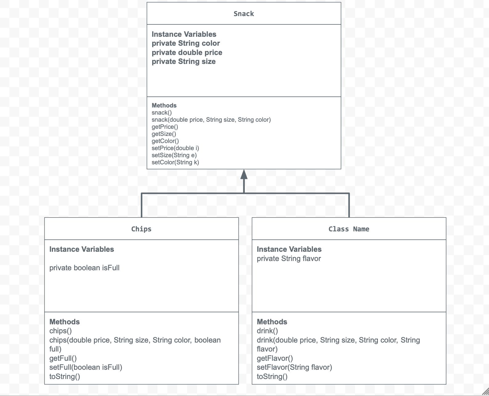

# Unit 2 - Store Management Project

## Introduction

You are opening a new business in your community! Businesses often need programs to manage the products and services they offer and track orders and requests from customers. Your goal is to create a store management system for your business.

## Requirements

Use your knowledge of object-oriented programming and class structure and design to create your store management system:
- **Create a class hierarchy** – Develop a superclass that represents a product or service your business offers and one or more subclasses that extend the superclass to represent more specific types of products or services.
- **Declare instance variables** – Declare instance variables in the superclass that are shared with the subclasses and instance variables in the subclasses that are not shared with the superclass.
- **Write constructors** – Write no-argument and parameterized constructors in the superclass and subclasses. Subclass constructors use the super keyword to call the superclass constructor.
- **Implement accessor and mutator methods** – Write accessor and mutator methods for instance variables that should be accessible and/or modifiable from outside of the class.
- **Implement a toString() method** – Write toString() methods in the superclass and subclasses that return information about the state of an object.

## UML Diagram

Embed your UML Diagram here. Upload the image of your UML Diagram to your repo, then use Markdown to insert your image here:

## Description

1. Write a description of your project here. Include what your store you made, and why you chose this topic. In your description, include as many vocab words from our class to explain how you represented the item/service from your store. If you have user input, explain how the user will interact with your store such as which questions are prompted to the user, what response is your program expecting, and how that is used to output information for your store in the console.

My project for Store Management, was mainly about a store selling snacks, chips, and drinks. In the real world, it is a convinience store such as a 7-11. I chose this topic as during this unit, there would be videos from code.org explaining concepts and they used food stores. I found it intersting how constructors were used when it came to customizability for a user wanting to have whatever food they would like. 

To actually build this, I built a super class of a snack with three private instance variables which are the same across any snack or drink. For the constructors I made two, a parameterized one and a non parameterized one. The parameterized one uses input and sets data to the instance variables and the non parameterized one uses the this method to set default values in the context of a conveinience store. I then used accessor methods, in case the user wanted to change something, which is nessacary as a user can't access a variable directly due to being private. I then added a mutator method to modify the snack in case the user wanted to change it. Finally, I added a toString() method to actually allow the customer to see what they were buying in a simpler way.

I kept the same process accross my subclasses such as drink, however there were some changes. For example, I added a new private instance variable as we got more specific into the snack, for example, the drink class contained a new flavor. I also had to use the super() method for each subclass constructor to set the values of the instance variables in the superclass. 

For user input, I had to use code.org's scanner class which basically allowed me to get user input. I incorperated this into my app as I added a feature to allow the user to customize their snack based off the data I have availble, which I found challenging at first as I tried to add the input to a new object at once, however; I realized I had to do it step by step, set it to a new variable and pass those variables as a new object. It will go like this, the store will welcome to user to my shop, then will show sample snacks, then will ask the user what snack they want and the characteristics. Then the user finally will input it, and the program will give the custom object back as a result to show the users snack.

2. How is this project related to STEAM (Science, Technology, Engineering, Art, and Mathematics)? Provide explicit examples from the project and details as possible. 

This project is mainly a technological project. This is because we used code and built a small algorithim with user input for a program to create a model conviniece store. For example, the app will welcome the user to a store, show model snacks they can get, and allows user customizability for the snack they would like. It also uses math in a slight way with data, for exmaple the use of a double variable for the price.

3. What SLOs did you demonstrate during completing this project?

Personally, I demonstrated problem solving. I ran into a roadblock while coding my app. It was the input for the user customizability. I used constructors wrong syntatically, so I had to go back and plan without code, sort of like a UML diagram planning, so I solved it by setting variables off input one by one.